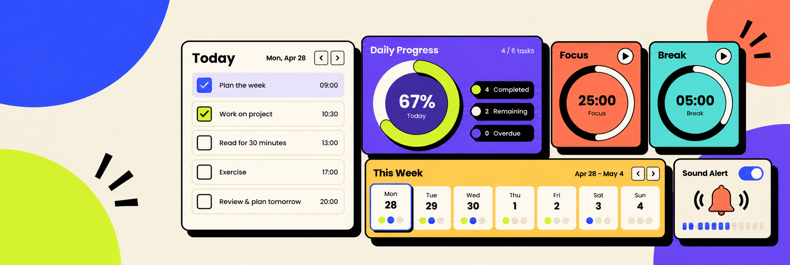

<div align="center">



# AION2Companion

### Organiza tus tareas, temporizadores y progreso desde un solo lugar.

[🌐 Abrir aplicación](https://aion2companion.netlify.app/) · [📚 Documentación](#-documentación) · [🛠️ Ejecutar en local](#-ejecutar-en-local)

**Español** · [English](#english)

</div>

> Proyecto independiente de fans. No está afiliado ni respaldado por NC ni por los titulares de AION 2.

## ✨ Qué puedes hacer

- ✅ Llevar contadores diarios y semanales y registrar el progreso a mano.
- 🪟 Abrir las **Diarias flotantes** desde Resumen en una ventana movible y redimensionable, siempre visible, con progreso y personaje sincronizados. Requiere un navegador de escritorio compatible con Document Picture-in-Picture (como Chrome o Edge) y mantener abierta la app.
- 🎮 Elegir **Apariencia del widget → Tema → AION · Interfaz del juego** para usar tarjetas translúcidas con títulos dorados y barra de progreso roja. La elección se guarda y puedes volver a Companion cuando quieras; en escritorio está junto al ajuste de opacidad.
- 🎉 Al completar una misión, la superpuesta conserva el sonido y los confetis; dos segundos después de terminar el audio, la tarjeta se desvanece y las demás ocupan el hueco suavemente. El progreso sigue en Resumen. Las tarjetas vuelven al reiniciar el progreso o empezar un nuevo día.
- 👤 Usar un perfil local o mantener el progreso separado por personaje, incluso en el mismo servidor.
- ⏱️ Consultar horarios comunitarios de jefes y eventos, y la cuenta atrás semanal.
- 🔔 Activar alarmas que funcionan desde cualquier sección, elegir la antelación (1–60 minutos) y cambiar el sonido o usar un audio propio.
- 🌗 Cambiar idioma (ES/EN) y tema claro u oscuro.
- 💾 Guardar los datos en este dispositivo, exportar una copia JSON e importarla después.
- 📲 Instalar la versión publicada como PWA. Tras cargar sus recursos, el shell puede abrirse sin conexión; los feeds requieren internet.

## 🧭 Fuentes y precisión

La app diferencia las publicaciones oficiales de NC de las referencias comunitarias. Los horarios recurrentes de eventos se basan en [Shugo.GG](https://shugo.gg/timers). Los reportes de Gartua proceden de un feed comunitario de [Aion2Timers](https://www.aion2timers.com/world-boss-timer/) y AbyssLogs. No son datos oficiales de NC y pueden variar según la región, el servidor y las actualizaciones.

El reinicio semanal Global se representa desde el **miércoles a las 16:00 KST** y se convierte a la hora local del navegador. Comprueba siempre los anuncios y el estado del juego. Consulta el [catálogo de reglas y fuentes](docs/official-rules-catalog.json) para conocer procedencia, región, revisión y limitaciones.

## 🔒 Datos y privacidad

Los perfiles, contadores, progreso y preferencias se guardan localmente en el navegador. No se sincronizan con una cuenta del juego. Al consultar Gartua, se envía el servidor seleccionado a una función de Netlify que solicita el feed comunitario; no se envían los nombres de personaje ni el progreso personal.

El enlace opcional de apoyo abre [Ko-fi](https://ko-fi.com/S0U1291G5B) en otra pestaña. AION2Companion no integra el formulario ni procesa pagos. Consulta la [política de privacidad](https://aion2companion.netlify.app/#privacy) y la [auditoría técnica](docs/compliance-audit.md) para ver el inventario de almacenamiento y comunicaciones.

## 🚀 Ejecutar en local

**Requisitos:** Node.js 20.19+ o 22.12+, y npm.

```sh
git clone https://github.com/AlbertoBeCi/AION2Companion.git
cd AION2Companion
npm install
npm run dev
```

Abre la URL local indicada por Vite, normalmente `http://localhost:5173`. El comando `npm run dev` usa el proxy local del feed de Gartua configurado en `vite.config.ts`.

### 🧪 Comprobaciones

```sh
npm test
npm run build
```

La compilación de producción queda en `dist/`. GitHub Actions también ejecuta pruebas y compilación en cambios dirigidos a `main` y en pull requests.

## 🪟 Widget de escritorio para Windows

Web y escritorio comparten este repositorio y los mismos componentes. El código de escritorio está en `desktop/` y los ejecutables descargables se publican en [Releases](https://github.com/AlbertoBeCi/AION2Companion/releases), fuera del código fuente.

La ventana principal conserva una cabecera con el estilo de la app y usa los botones nativos de Windows para minimizar, maximizar/restaurar y cerrar. Puedes arrastrarla a un borde o una esquina para ocupar media pantalla o un cuarto, y redimensionar desde sus bordes. En Windows 11, coloca el puntero sobre maximizar o pulsa **Win + Z** para elegir una distribución de ventanas. Estas opciones requieren tener activado **Configuración → Sistema → Multitarea → Acoplar ventanas**. El tamaño mínimo es de 360 × 320 para permitir distribuciones pequeñas; el contenido se adapta y se puede desplazar. Las barras de desplazamiento están ocultas; la rueda del ratón y el teclado siguen permitiendo navegar. Web, PWA y escritorio usan el mismo icono.

La versión de escritorio muestra las diarias **sin barra del navegador ni marco de Windows**, en una ventana siempre visible. Se abre desde **Resumen → Diarias flotantes**. Arrastra su cabecera para moverla y la esquina inferior derecha para cambiar el tamaño. El botón junto a cerrar recupera la app principal; puedes minimizarla y seguir usando el widget. El fondo es transparente y no se muestra barra de desplazamiento; la rueda del ratón permite recorrer las listas largas. En el botón de apariencia de la cabecera puedes ajustar la opacidad entre 25% y 100%. Se recuerdan la opacidad, la posición, el tamaño y el personaje seleccionado.

El ejecutable portátil se genera en `release/AION2-Companion-<versión>-Windows.exe` y no necesita instalarse ni arrancar un servidor local. Los datos se guardan en `%APPDATA%/AION2Companion`, compartidos entre la app de escritorio y el widget. El navegador guarda sus datos por separado: usa **Ajustes → Exportar copia** en la web y **Ajustes → Importar copia** en escritorio para trasladarlos. El progreso posterior se sincroniza entre las dos ventanas de escritorio.

```sh
npm install
npm run desktop        # compilar y abrir la app de escritorio
npm run desktop:test   # comprobar las ventanas con un perfil de prueba aislado
npm run desktop:pack   # generar el ejecutable portátil de Windows x64
```

Desde **Resumen → Mis alarmas → Alarmas flotantes** puedes abrir una segunda ventana siempre visible, sincronizada con las alarmas que actives o desactives en Temporizadores. Tiene los temas **Companion** y **AION · Interfaz del juego**, opacidad de 25% a 100%, cabecera para arrastrar y esquina para redimensionar. Cada flotante recuerda su propio tema, opacidad, tamaño y posición. Cerrar las diarias deja las alarmas abiertas y viceversa. La app principal reproduce los avisos una sola vez aunque ambas flotantes estén abiertas o la principal esté minimizada.

Las alarmas flotantes muestran temporizadores, sin marcadores de misión. La barra roja se llena conforme se agota el tiempo: entre el final de un evento y su siguiente comienzo, o durante su duración cuando está activo. Para Gartua, la barra usa el tramo de antelación configurado; si el feed no da una próxima hora válida, se muestra su estado sin inventar un progreso.

Para superponer los widgets al juego, usa modo ventana o ventana sin bordes si la pantalla completa exclusiva los oculta. Cerrar un widget deja los demás abiertos; cerrar la app principal cierra las ventanas flotantes. Los feeds siguen necesitando conexión a internet.

## 🧰 Stack

React · TypeScript · Vite · Dexie/IndexedDB · Zustand · i18next · Lucide · Motion · PWA/Workbox · Netlify Functions.

## 📚 Documentación

- [Auditoría funcional de referencia](docs/reference-audit.md)
- [Inventario funcional](docs/functional-inventory.md)
- [Matriz de paridad y evidencias](docs/feature-parity-matrix.md)
- [Catálogo de reglas y fuentes](docs/official-rules-catalog.json)
- [Auditoría técnica de privacidad y cumplimiento](docs/compliance-audit.md)
- Licencias SIL OFL 1.1: [DM Sans](docs/licenses/DM-Sans-OFL.txt) y [Space Grotesk](docs/licenses/Space-Grotesk-OFL.txt).

## ☕ Apoyar el proyecto

Si te resulta útil, puedes [invitarme a un café en Ko-fi](https://ko-fi.com/S0U1291G5B). ¡Gracias por apoyar el desarrollo! 💛

---

<a id="english"></a>

<div align="center">


# AION2Companion

### Keep your tasks, timers, and progress in one place.

[🌐 Open the app](https://aion2companion.netlify.app/) · [📚 Documentation](#-documentation-1) · [🛠️ Run locally](#-run-locally)

[Español](#aion2companion) · **English**

</div>

> Independent fan project. Not affiliated with or endorsed by NC or the AION 2 rights holders.

## ✨ What you can do

- ✅ Track daily and weekly counters and record progress manually.
- 🪟 Open **Floating daily** from Overview in a movable, resizable, always-on-top window with synchronized progress and character selection. Requires a desktop browser supporting Document Picture-in-Picture (such as Chrome or Edge), with the app kept open.
- 🎮 Choose **Widget appearance → Theme → AION · Game interface** for translucent cards with gold titles and a red progress bar. Your choice is remembered and Companion remains available; the desktop widget also keeps its opacity control here.
- 🎉 Completed floating missions keep their sound and confetti. Two seconds after the audio ends, the card fades and the remaining cards smoothly close the gap. Progress stays in Overview; cards return when reset or on a new day.
- 👤 Use a local profile or track each character independently, even on the same server.
- ⏱️ View community schedules for bosses and events, plus the weekly countdown.
- 🔔 Enable alerts across every app page, choose the lead time (1–60 minutes), and select a sound or upload your own audio.
- 🌗 Switch between Spanish and English and light or dark themes.
- 💾 Keep data on this device, export a JSON backup, and import it later.
- 📲 Install the production app as a PWA. After its resources load, the app shell can open offline; community feeds need internet access.

## 🧭 Sources and accuracy

The app distinguishes NC publications from community references. Recurring event schedules are based on [Shugo.GG](https://shugo.gg/timers). Gartua reports come from a community feed provided by [Aion2Timers](https://www.aion2timers.com/world-boss-timer/) and AbyssLogs. These are not official NC data and can vary by region, server, and game update.

The Global weekly reset is shown as **Wednesday at 16:00 KST** and converted to the browser's local time. Always check in-game notices and status. The [rules and sources catalogue](docs/official-rules-catalog.json) records provenance, region, review date, and limitations.

## 🔒 Data and privacy

Profiles, trackers, progress, and preferences are stored locally in the browser. They are not synced to a game account. When you check Gartua, the selected server is sent to a Netlify function that requests the community feed; character names and personal progress are not sent.

The optional support link opens [Ko-fi](https://ko-fi.com/S0U1291G5B) in a new tab. AION2Companion does not embed its form or process payments. See the [privacy policy](https://aion2companion.netlify.app/#privacy) and [technical audit](docs/compliance-audit.md) for the storage and communication inventory.

## 🚀 Run locally

**Requirements:** Node.js 20.19+ or 22.12+, and npm.

```sh
git clone https://github.com/AlbertoBeCi/AION2Companion.git
cd AION2Companion
npm install
npm run dev
```

Open the local URL printed by Vite, usually `http://localhost:5173`. `npm run dev` uses the local Gartua feed proxy configured in `vite.config.ts`.

### 🧪 Checks

```sh
npm test
npm run build
```

The production build is written to `dist/`. GitHub Actions also runs tests and builds for changes targeting `main` and for pull requests.

## 🧰 Tech stack

React · TypeScript · Vite · Dexie/IndexedDB · Zustand · i18next · Lucide · Motion · PWA/Workbox · Netlify Functions.

## 📚 Documentation

- [Reference functional audit](docs/reference-audit.md)
- [Functional inventory](docs/functional-inventory.md)
- [Parity and evidence matrix](docs/feature-parity-matrix.md)
- [Rules and sources catalogue](docs/official-rules-catalog.json)
- [Technical privacy and compliance audit](docs/compliance-audit.md)
- SIL OFL 1.1 licenses: [DM Sans](docs/licenses/DM-Sans-OFL.txt) and [Space Grotesk](docs/licenses/Space-Grotesk-OFL.txt).

## ☕ Support the project

If you find it useful, you can [buy me a coffee on Ko-fi](https://ko-fi.com/S0U1291G5B). Thanks for supporting development! 💛
